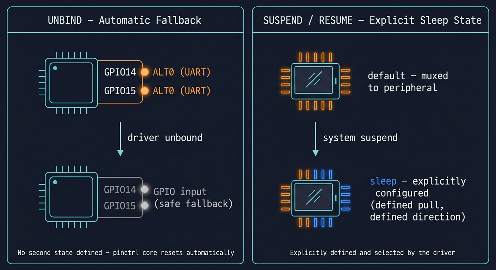

# Pin Control & Pinmux

## Video :-

[](https://www.youtube.com/watch?v=h9DxOG50sAk)

> The video was recorded on a Raspberry Pi. The **pinctrl consumer API** (`devm_pinctrl_get()`,
> `pinctrl_lookup_state()`, `pinctrl_select_state()`) and the driver are the same on the BeagleBone Black,
> but the **pin controller hardware and its Device Tree binding are completely different** – this readme
> describes the AM335x version.

## 1. What Is Pin Control?

Every pad on the BeagleBone Black's AM335x can do more than one job. The pad behind header pin **P9_24**,
for example, can be UART1 TXD, DCAN1 RX, I2C1 SCL … or a plain GPIO (GPIO0_15). That routing decision is
called **pin muxing**, and the kernel subsystem that manages it is **pinctrl**.

On the Raspberry Pi (BCM283x/BCM2711) the GPIO controller *is* the pin controller, so pin config nodes live under
`&gpio`. **The AM335x is the more common case: two separate hardware blocks.**

| Block | Address | Linux driver | DT label |
|---|---|---|---|
| Pin controller = *Control Module* pad registers | `0x44E10800` – `0x44E10A34` | `pinctrl-single` | `&am33xx_pinmux` |
| GPIO banks 0..3 (32 lines each) | `0x44E07000`, `0x4804C000`, `0x481AC000`, `0x481AE000` | `gpio-omap` | `&gpio0` … `&gpio3` |

Two things happen in this space:

- **Muxing** : picking which internal peripheral a pad is connected to (`MUXMODE` 0..7, **7 = GPIO** on every header pad)
- **Configuration** : pull-up/pull-down, input buffer, slew rate

## 2. Pin Configuration in Device Tree

`pinctrl-single` is a *generic* driver: it knows nothing about AM335x signal names, it just writes a value into
a register at an offset. Each pad is one 32-bit register:

| Bits | Field | Meaning |
|---|---|---|
| 2:0 | `MUXMODE` | 0 – 7, the function (see the AM335x datasheet "Pin Attributes" table) |
| 3 | `PULLUDEN` | **0 = pull enabled**, 1 = pull disabled |
| 4 | `PULLTYPESEL` | 0 = pull-down, 1 = pull-up |
| 5 | `RXACTIVE` | 1 = input buffer enabled (needed for any input, incl. I2C/SPI clocks) |
| 6 | `SLEWCTRL` | 0 = fast, 1 = slow |

The kernel header `<dt-bindings/pinctrl/am33xx.h>` gives readable names:

| Macro | Value | Typical use |
|---|---|---|
| `PIN_OUTPUT` | `0x08` | output, no pull |
| `PIN_OUTPUT_PULLUP` | `0x10` | output, pull-up |
| `PIN_OUTPUT_PULLDOWN` | `0x00` | output, pull-down |
| `PIN_INPUT` | `0x28` | input, no pull |
| `PIN_INPUT_PULLUP` | `0x30` | input, pull-up |
| `PIN_INPUT_PULLDOWN` | `0x20` | input, pull-down |
| `MUX_MODE0` … `MUX_MODE7` | 0 – 7 | the function |

A pin config node lists `<offset conf mux>` triplets (the AM335x `pinmux` node has `#pinctrl-cells = <2>`).
`AM33XX_PADCONF(pad, conf, mux)` builds the triplet and subtracts the `0x800` base for you:

```dts
#include <dt-bindings/pinctrl/am33xx.h>

&am33xx_pinmux {
    pinctrl_demo_default: pinctrl-demo-default-pins {
        pinctrl-single,pins = <
            AM33XX_PADCONF(AM335X_PIN_UART1_TXD, PIN_INPUT_PULLDOWN, MUX_MODE7)  /* P9_24 -> gpio0_15 */
            AM33XX_PADCONF(AM335X_PIN_UART1_RXD, PIN_INPUT_PULLDOWN, MUX_MODE7)  /* P9_26 -> gpio0_14 */
        >;
    };
};
/* expands to:  pinctrl-single,pins = <0x184 0x20 0x07  0x180 0x20 0x07>; */
```

> Older (4.x) BeagleBone trees used two cells, `<0x184 0x27>` (offset, conf|mux). Current kernels expect three.
> The `.dts` files in this repo are passed through `cpp -I $(KDIR)/include` by the `Makefile`,
> so these macros work out of the box.

A device that wants to use a particular pin configuration references it through two standard properties:

```dts
pinctrl-names = "default", "uart";
pinctrl-0 = <&pinctrl_demo_default>;
pinctrl-1 = <&pinctrl_demo_uart>;
```

`pinctrl-names` is a list of labels. `pinctrl-N` points at the phandle of the pin config node that corresponds
to the name at **index N**. The state named `"default"` is special - the kernel automatically applies it right
before your driver's `probe()` runs, with no extra code required.

## 3. Alternate Functions on BeagleBone Black Pins

Every pad has up to eight modes. A few used in this series (full list: AM335x datasheet / BBB System Reference Manual):

| Pin | Pad (offset) | Mode 0 | Mode 2 | Mode 3 | Mode 7 |
|---|---|---|---|---|---|
| P9_24 | `uart1_txd` (0x184) | UART1 TXD | DCAN1 RX | I2C1 SCL | GPIO0_15 |
| P9_26 | `uart1_rxd` (0x180) | UART1 RXD | DCAN1 TX | I2C1 SDA | GPIO0_14 |
| P9_19 | `uart1_rtsn` (0x17C) | UART1 RTSn | DCAN0 RX | **I2C2 SCL** | GPIO0_13 |
| P9_20 | `uart1_ctsn` (0x178) | UART1 CTSn | DCAN0 TX | **I2C2 SDA** | GPIO0_12 |
| P9_22 | `spi0_sclk` (0x150) | **SPI0 SCLK** | I2C2 SDA | – | GPIO0_2 |
| P9_12 | `gpmc_ben1` (0x078) | GPMC BEn1 | – | – | **GPIO1_28** |

This is exactly what has been happening behind the scenes in the I2C chapters: the base device tree
(`am335x-bone-common.dtsi`) muxes P9_19/P9_20 to **mode 3 = I2C2** with `PIN_INPUT_PULLUP`.

### cape-universal vs. your own pinmux

The stock image enables **cape-universal** (`enable_uboot_cape_universal=1` in `/boot/uEnv.txt`). It creates a
`bone-pinmux-helper` device for almost every header pin – that is what `config-pin` talks to. Those helpers
**own** the pads, so a second device asking for the same pads fails with
`pin PIN... already requested by ...`. Before using an overlay with its own `pinctrl-single,pins`, disable it:

```bash
sudo sed -i 's/^enable_uboot_cape_universal=1/#enable_uboot_cape_universal=1/' /boot/uEnv.txt
# or let `make install` do it (it calls tools/bbb_overlay.sh enable ... --no-universal)
```

`config-pin` stops working after that – the pads are now under your overlays' control.

## 4. Example Files

| File | Purpose |
|---|---|
| `dts/pinctrl_demo_overlay.dts` | Overlay defining two pin states and a dummy consumer device |
| `src/pinctrl_demo.c` | Platform driver that requests both states and switches between them via sysfs |

### `pinctrl_demo_overlay.dts`

Two fragments:

- **Fragment 0** adds two pin config nodes under `&am33xx_pinmux`:
  - `pinctrl_demo_default` : P9_24 / P9_26 in mode 7 (GPIO0_15 / GPIO0_14), inputs with pull-down
  - `pinctrl_demo_uart` : P9_24 / P9_26 in mode 0 (UART1 TXD / RXD), RXD pulled up
- **Fragment 1** adds a dummy platform device, `mpcoding,pinctrl-demo`, whose `pinctrl-0`/`pinctrl-1` point at those two states.

### `pinctrl_demo.c`

- `devm_pinctrl_get()` : grabs the pinctrl handle for this device (this doesn't apply anything by itself)
- `pinctrl_lookup_state()` : resolves the `"default"` and `"uart"` labels to `pinctrl_state` pointers
- `pinctrl_select_state()` : actually applies a state to hardware; called once in `probe()` to make sure we start from a known state, and again from the sysfs `store` callback to switch on demand
- A `pin_state` sysfs attribute (`show`/`store`) lets you flip between `"default"` and `"uart"` from userspace, in the same style as the sysfs work from Tutorial 22

(The Raspberry Pi version calls the second state `"alt0"`; on the AM335x the UART function is *mode 0*, so it is named `"uart"` here.)

## 5. Build & Test

### Build source and overlay using Makefile
```bash
make
```

### Install the overlay (once) and reboot
```bash
make install          # copies the .dtbo to /lib/firmware, adds it to /boot/uEnv.txt, disables cape-universal
sudo reboot
```

### Load the driver
```bash
make load
```

Expected `dmesg` output:

```
[*********] pinctrl_demo pinctrl_demo@0: pinctrl demo probed, P9_24/P9_26 are GPIO inputs (default state)
```

### Confirm the pad configuration

`raspi-gpio` doesn't exist here – the pinctrl debugfs files show the raw pad registers instead.
Pad register = `0x44E10800 + offset`, pin index = `offset / 4`: P9_26 (`0x180`) is pin 96 at `44e10980`,
P9_24 (`0x184`) is pin 97 at `44e10984`.

```bash
ls /sys/kernel/debug/pinctrl/                       # e.g. 44e10800.pinmux-pinctrl-single
P=/sys/kernel/debug/pinctrl/44e10800.pinmux-pinctrl-single

sudo grep -E "44e1098[04]" $P/pins
# pin 96 (PIN96) ... 44e10980 00000027 pinctrl-single     <- 0x27 = input, pull-down, mode 7
# pin 97 (PIN97) ... 44e10984 00000027 pinctrl-single

sudo grep -E "pin 9[67] " $P/pinmux-pins
# pin 96 (PIN96): device pinctrl_demo@0 function pinctrl-demo-default-pins ...
```

### Switch to UART mode and back

```bash
cat /sys/devices/platform/pinctrl_demo@0/pin_state
# default

echo uart | sudo tee /sys/devices/platform/pinctrl_demo@0/pin_state
dmesg | tail -1
# pinctrl_demo pinctrl_demo@0: pin state switched to "uart"

sudo grep -E "44e1098[04]" $P/pins
# ... 44e10980 00000030 ...    <- RXD: input, pull-up, mode 0
# ... 44e10984 00000000 ...    <- TXD: output, pull-down, mode 0

echo default | sudo tee /sys/devices/platform/pinctrl_demo@0/pin_state
```

### Unload

```bash
make unload
make uninstall && sudo reboot      # remove the overlay again (re-enable cape-universal by hand if you want config-pin back)
```

## 6. Summary

| Concept | Where it lives |
|---|---|
| Pin muxing + config | Under `&am33xx_pinmux` (pinctrl-single): `pinctrl-single,pins = <AM33XX_PADCONF(pad, conf, mode)>` |
| GPIO lines | Separate controllers `&gpio0..3`, referenced as `<&gpio1 28 GPIO_ACTIVE_HIGH>` |
| Which state a device wants | `pinctrl-names` + `pinctrl-N` on the consumer node |
| Automatic default state | Applied by the kernel before `probe()`, no driver code needed |
| Manual state switching | `pinctrl_lookup_state()` + `pinctrl_select_state()` in driver code |
| Shell-level muxing | `config-pin` – only while cape-universal is enabled |

------------------------

>> **So to summarize:** unbinding relies on the automatic fallback, while suspend and resume, when used, rely on an explicitly defined state.


